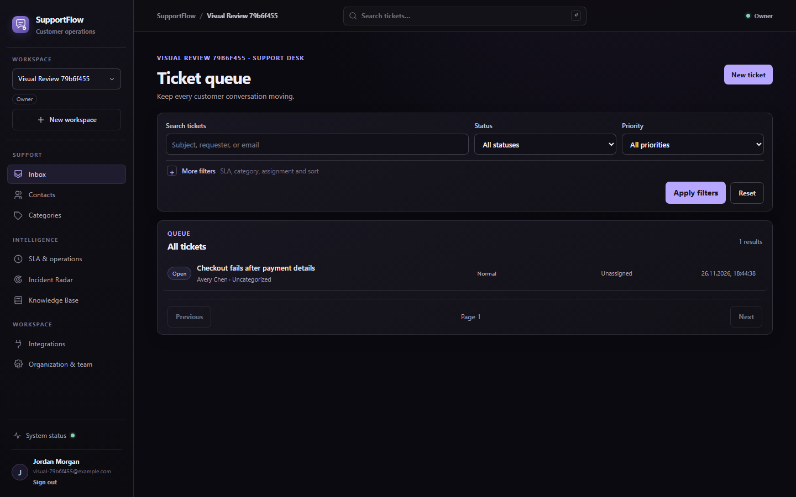
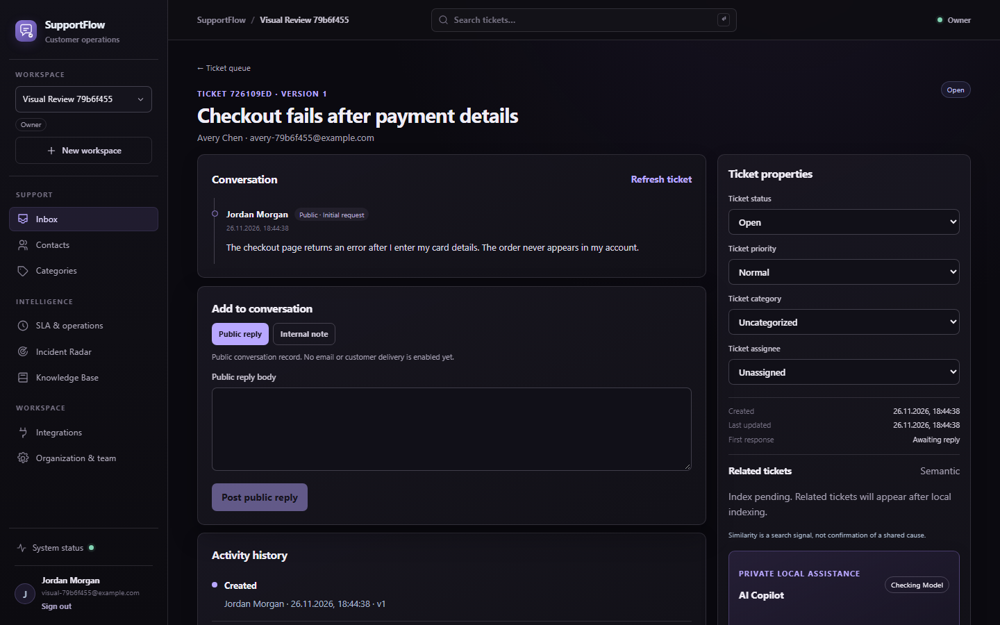
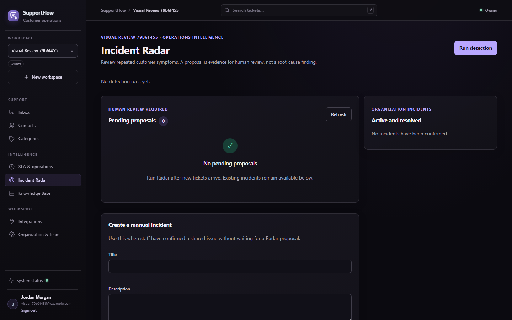
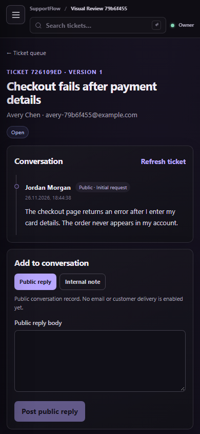
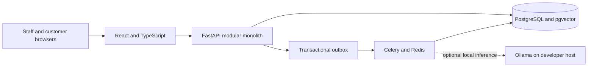

# SupportFlow AI

**A smarter, self-hosted helpdesk for teams that want to resolve issues, not just track them.**

[](https://github.com/ree1o/SupportFlowAI/actions/workflows/ci.yml)

SupportFlow AI brings customer conversations, team workflows, SLA tracking, and incident management into one workspace. Staff can discover related tickets with local multilingual semantic search and optionally use a private local AI Copilot grounded in approved Knowledge Base articles.

## What it does

- **Keep support organized.** Create, assign, prioritize, and resolve tickets with a complete activity history, public replies, and private internal notes.
- **Give customers a portal.** Let customers access their own tickets, reply to agents, and receive notifications.
- **Stay ahead of deadlines.** Set SLA targets by priority, monitor response and resolution times, and get breach alerts and operational reports.
- **Connect other systems.** Receive tickets and messages through signed webhooks with contact-scoped access, key rotation, and duplicate-event protection.
- **Spot recurring problems.** Incident Radar groups related reports into explainable proposals that staff review before creating an incident.
- **Find useful context faster.** Related Tickets uses local embeddings and PostgreSQL `pgvector` to surface semantically similar requests, including across languages.
- **Draft with approved guidance.** The optional local AI Copilot summarizes public conversations, drafts cited replies, and can use a bounded set of read-only tools. Staff review every draft; nothing is sent automatically.
- **Protect each workspace.** Organization isolation, role-based permissions, PostgreSQL row-level security, CSRF protection, audit trails, and targeted rate limits.

> **AI, with human control:** Incident Radar uses explainable rules, while Related Tickets uses semantic similarity. Neither automatically diagnoses a root cause or sends AI-generated replies.

## Product screenshots

These screenshots show the current interface with disposable synthetic demo records. They contain no customer or production data.

<p align="center">
  <a href="docs/screenshots/ticket-queue.png"></a>
  <a href="docs/screenshots/ticket-workspace.png"></a>
</p>
<p align="center">
  <a href="docs/screenshots/incident-radar.png"></a>
  <a href="docs/screenshots/mobile-ticket-workspace.png"></a>
</p>

## Tech stack

| Layer | Technologies |
| --- | --- |
| Frontend | React, TypeScript, Vite |
| Backend | Python, FastAPI, SQLAlchemy, Alembic |
| Data | PostgreSQL 16, pgvector, Redis |
| Background jobs | Celery, transactional outbox |
| Semantic search | FastEmbed, local CPU embeddings |
| Development & quality | Docker Compose, Mailpit, pytest, Playwright, GitHub Actions |

## Architecture at a glance

SupportFlow is a modular monolith: one FastAPI application contains explicit domain modules for identity, tickets, customers, SLAs, integrations, incidents, semantic retrieval, and AI assistance. Routers handle HTTP validation and response schemas; service functions own business rules and transaction boundaries; synchronous SQLAlchemy and Alembic manage PostgreSQL persistence.

PostgreSQL is the source of truth, including `pgvector` embeddings. Explicit service authorization is reinforced by forced row-level security for tenant-owned data. Durable outbox records let Celery workers process notifications, indexing, SLA scans, and other background work through Redis without putting external calls inside business transactions. The optional generative model runs locally through Ollama; no hosted AI provider is configured or required.



The diagram is intentionally simplified. See [system architecture](docs/architecture.md) and [security hardening](docs/security-hardening.md) for tenant boundaries, runtime roles, and failure handling.

## AI capabilities and limits

- **Semantic retrieval** uses local multilingual embeddings to rank same-organization tickets. Similarity is a discovery signal, not evidence of a shared root cause.
- **Incident Radar** is a separate deterministic detector. It proposes groups with stored evidence for staff review; it does not auto-confirm or claim root-cause certainty.
- **The optional Copilot** retrieves published Knowledge Base chunks, returns source citations, summarizes conversations, and can invoke a small allowlist of bounded read-only tools. Staff decide whether to edit and send each suggested reply.
- **Privacy by default:** embedding and generation inference are local. Internal notes and unrelated customer data are excluded from public reply context. Ollama is optional, and helpdesk workflows remain available when it is offline.

The current Copilot did **not** meet the proposed grounding and abstention targets in the held-out synthetic evaluation. The evaluation is small and synthetic, not a production-quality claim; generated content must be reviewed. Read [the measured evaluation and limitations](docs/ai-evaluation.md).

## Run locally

**Requirements:** Docker Desktop with WSL 2 and Linux containers (Windows), or Docker Engine with Compose on Linux/macOS.

From a fresh clone, in **PowerShell**:

```powershell
git clone https://github.com/ree1o/SupportFlowAI.git
cd SupportFlowAI
Copy-Item .env.example .env
docker compose up --build -d --wait --wait-timeout 240
```

For semantic ticket suggestions, download the local embedding model once:

```powershell
docker compose run --rm worker python -m app.semantic.setup_model
```

| Open | URL |
| --- | --- |
| SupportFlow AI | http://localhost:5173 |
| Email inbox (Mailpit) | http://localhost:8025 |
| API documentation | http://localhost:8000/api/docs |

**Try it:** Register an account and workspace, add a contact, and create a ticket. Post a public reply and an internal note; then explore **SLA & operations**, **Incident Radar**, **Related Tickets**, and the Knowledge Base.

### Optional local AI

The helpdesk works without Ollama. To opt in on Windows, install Ollama locally and
download the documented model once:

```powershell
ollama pull qwen3.5:4b-q4_K_M
docker compose run --rm worker-ai python -m app.knowledge.setup_model
```

In the ignored `.env`, set `SUPPORTFLOW_AI_ENABLED=true` and keep the approved local
endpoint `SUPPORTFLOW_AI_OLLAMA_URL=http://host.docker.internal:11434`. Restart with
`docker compose up --build -d --wait`. Restrict Ollama access to the local host/Docker
network; never expose its unauthenticated API publicly. See [local AI setup](docs/local-ai.md)
and [Copilot security and behavior](docs/ai-copilot.md).

The Copilot is experimental. The current held-out synthetic evaluation missed its proposed
grounding and abstention targets; every generated draft must be checked and edited by a
staff member before use. The system never sends generated replies automatically. See the
[evaluation report](docs/ai-evaluation.md) for the measured results and limitations.

### Run checks

Use a dedicated disposable PostgreSQL database whose name ends in `_test`; never point
`TEST_DATABASE_URL` at the normal development database. With the project virtual environment
and database access configured:

```powershell
$env:TEST_DATABASE_URL = "postgresql+psycopg://<test-user>:<test-password>@127.0.0.1:15432/supportflow_test"
cd backend
..\.venv\Scripts\pytest.exe
..\.venv\Scripts\ruff.exe check .
..\.venv\Scripts\ruff.exe format --check .
..\.venv\Scripts\python.exe -m mypy app
..\.venv\Scripts\python.exe -m pip check
cd ..\frontend
npm.cmd run build
npm.cmd run test:e2e
```

The opt-in local-model smoke test is separate: set `RUN_LOCAL_AI_SMOKE=1` only after
configuring the documented local Ollama model. Standard CI does not download or run a
generative model. There are no default demo credentials; create synthetic demo accounts
through onboarding and use Mailpit for local invitation/verification messages.

To stop the stack safely:

```powershell
docker compose down
```

The PostgreSQL volume is preserved by `docker compose down`. **Do not use `down -v`** unless you intentionally want to erase local data. Keep your existing `.env` when restarting.

> **Deployment note:** The provided Compose setup is for local development and demonstration, with ports bound to `127.0.0.1`. Public deployment requires production configuration, TLS, and appropriately managed secrets.

## Tested and documented

The final local M10 verification completed **208 backend tests** against a dedicated PostgreSQL `_test` database, with one opt-in model test excluded from the standard run and **1 real-model smoke test passing separately**. All **20 desktop/mobile Playwright scenarios** passed. Docker Compose built and started with PostgreSQL, Redis, API, both workers, frontend, and Mailpit healthy. Live Docker verification completed a grounded, cited reply, a conversation summary, and bounded tool-assisted analysis. The pushed M10 completion commit passed the GitHub Actions **backend, frontend, and compose-smoke** jobs. The local Copilot evaluation, unmet quality targets, and limitations remain documented in [M10 evaluation](docs/ai-evaluation.md).

**Explore the details:** [Architecture](docs/architecture.md) · [Customer portal](docs/customer-portal.md) · [SLA](docs/sla.md) · [Integrations](docs/integrations.md) · [Incident Radar](docs/incident-radar.md) · [Semantic search](docs/semantic-retrieval.md) · [Knowledge Base and Copilot](docs/ai-copilot.md) · [AI evaluation](docs/ai-evaluation.md) · [Local model setup](docs/local-ai.md) · [Security](docs/security-hardening.md) · [Backup & recovery](docs/backup-recovery.md) · [Verification](docs/m9-verification.md) · [Release walkthrough](docs/release-readiness.md)
