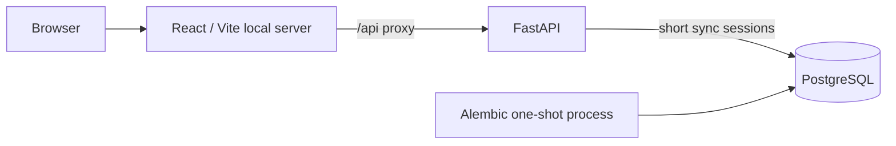
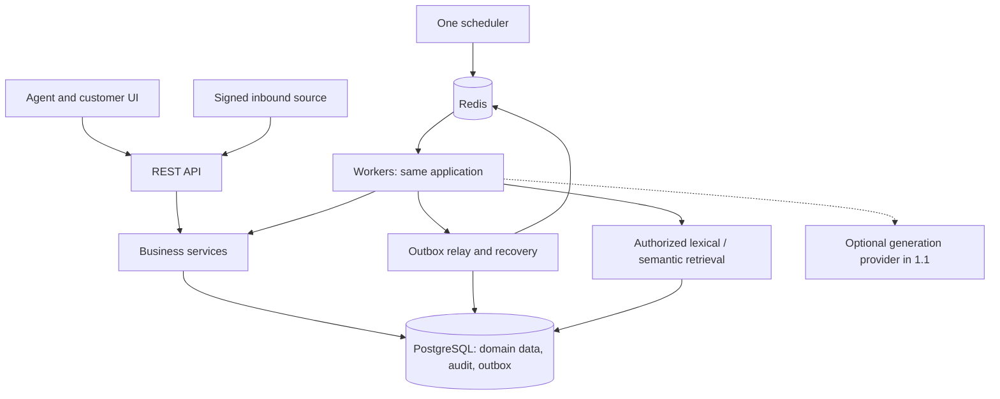

# Architecture — approved direction, M2 implementation boundary

Status: approved direction with release adjustments, 2026-10-28.
This document distinguishes intended architecture from implemented functionality.
M1 and M2 are implemented. See [identity design](identity.md) for current endpoints,
permissions, session/CSRF behavior and limitations. Tickets, queues and AI remain future work.

## Product and scope

SupportFlow AI is a multi-tenant customer support platform. The helpdesk must remain
usable with every AI provider disabled. Backend correctness comes before generation.
An organization is the tenant; there is no additional workspace hierarchy.
Users are global identities; staff memberships and customer access are distinct.
English demo data, one region, modest volumes, and one developer are initial assumptions.

## Decisions

| Decision | Choice and trade-off |
| --- | --- |
| Application structure | Modular monolith, one codebase and relational database. Separate API/worker processes later are not microservices. |
| API | FastAPI and Pydantic; typed REST boundaries without unnecessary internal HTTP calls. |
| Persistence | Synchronous SQLAlchemy and Psycopg; simpler transaction handling shared by API and future Celery workers. |
| Schema changes | Alembic is the only schema lifecycle mechanism. No startup `create_all`. |
| Transactions | Services own explicit transactions; request dependencies close/roll back sessions but never silently commit. |
| Concurrency | Future mutable aggregates have a version; stale writes return 409. Short row locks protect multi-row invariants. |
| Authentication (M2) | Opaque server-side sessions, hashed credentials, secure cookies, CSRF protection. No mandatory JWT. |
| Isolation (M2 onward) | Explicit organization-scoped queries, authorization tests, and composite tenant foreign keys. |
| RLS | Defense in depth in release 1.0. Not a substitute for application authorization. Separate migration/runtime privileges then. |
| Queue (0.2) | Celery + Redis only when notifications and SLA scans need durable execution. PostgreSQL outbox is authoritative. |
| Frontend | React + TypeScript + Vite. Same-origin `/api` proxy; polling before SSE/WebSockets. |
| Retrieval (0.3) | Lexical baseline, then local embeddings and pgvector, evaluated on held-out cases. |
| Generation (1.1) | Optional providers and test fakes; approved drafts only, never autonomous sends. |
| Observability | Structured logs and request IDs now; job metrics later. No monitoring cluster without a requirement. |

No Kafka, Kubernetes, dedicated vector database, object storage, or microservices in M1.
Async network I/O may later benefit bounded outgoing delivery batches. Blocking database
operations use synchronous routes and must not be placed directly on the event loop.
CPU-heavy embeddings run in workers, not API requests.

## Current M2 deployment

Compose waits for database health, then a successful migration, then starts the API.
The frontend container is a local development/preview server, not a production hosting
configuration. Database/API/frontend published ports bind to loopback.

## Target modular monolith

Modules are introduced when a feature needs them: identity/tenancy, tickets, SLA,
notifications/integrations, incidents, knowledge, AI assistance, reporting.
Routes validate/authenticate and call services. Services enforce policy and own writes.
Focused queries are sufficient; no generic repository framework is required.
Tickets do not depend on AI. Incidents can be managed without detection models.
Workers call the same services as API handlers. Reporting is read-only.

## Session, health, configuration, and logs (M1)

- Settings are validated before startup; the database URL is required and secret-masked.
- Only `postgresql+psycopg` URLs are accepted. SQL echo is disabled; SQL parameters are hidden.
- One engine/pool per application process, disposed at shutdown. Bounded pool and connection/query timeouts.
- A request gets an independent session; no shared global session and no implicit commits.
- `/api/health/live`: process is running, independent of PostgreSQL.
- `/api/health/ready`: checks PostgreSQL and the expected Alembic revision; 503 if unavailable or unmigrated.
- Liveness stays healthy during a database outage. Startup does not require a successful DB connection.
- JSON request logs include server-generated request ID, method, matched route, status, duration.
- Request bodies, query strings, database credentials, and raw exception text are not logged.
- Error responses include stable codes and request IDs, never raw database exceptions.
- Configuration via environment or root `.env`; no production secrets committed.

## Incident permissions (0.3; no new roles)

| Action | Owner | Administrator | Agent |
| --- | --- | --- | --- |
| View incidents/evidence in own organization | Yes | Yes | Yes |
| Report a suspected incident / propose a candidate ticket | Yes | Yes | Yes |
| Create a confirmed manual incident | Yes | Yes | No |
| Confirm or reject automated proposals | Yes | Yes | No |
| Link/unlink tickets on a confirmed incident | Yes | Yes | No |
| Change severity, owner, or incident status | Yes | Yes | No |
| Approve customer-wide incident communication | Yes | Yes | No |
| Reply on an individual ticket | Yes | Yes | Yes, under ticket permissions |

Agent suggestions are non-authoritative. Customers see their own public conversations,
not incident evidence, other customers, or internal notes. All mutations are audited.

## Security and reliability progression

M1 has no user/domain records: loopback development bindings, validated input/config,
sanitized errors/logs, non-root application containers, and ignored local secrets.
M2 enforces authorization and tenant isolation for identity and organization records.
Future child references use `(organization_id, parent_id)` foreign keys against
`(organization_id, id)` unique keys; a UUID alone grants no access.
RLS is deliberately deferred to 1.0: runtime non-owner role, transaction-local tenant
context, fail-closed missing context, worker coverage, and connection reuse tests.
Do not admit real customer data before release hardening and a deployment review.

In 0.2, business change + audit + outbox are one transaction. Publishing may repeat.
Logical operation IDs, unique effects, expiring claims, bounded retries, recovery,
and recorded terminal failures provide retryable processing, not exactly-once execution.
An external receiver may have acted despite a timeout; stable delivery IDs support
deduplication where the receiver supports it. SMTP cannot guarantee exactly-once delivery.

## SLA contract (0.2)

Continuous UTC time; first public human response and first resolution only. Internal
notes, automatic acknowledgements, and drafts do not count. Waiting status does not
pause time. Reopening preserves first-response/first-resolution metrics and does not
start a new SLA cycle. Snapshot policy durations at creation; later priority edits
do not silently rewrite deadlines. Equality with a deadline is on time.
Late scans infer historical breaches from timestamps but suppress obsolete alerts.
Reporting includes completed targets or passed deadlines, excluding open not-yet-due targets.

## AI and Incident Radar progression

0.3 starts with manual incidents, then bounded time windows, shared issue/error terms,
distinct contacts, transparent evidence, and rejection suppression. Similar symptoms
are not proof of a shared root cause. Compare semantic candidate expansion against
the lexical baseline; split evaluation by incident/scenario, not random paraphrase.
Track precision/recall, false proposals, retrieval precision@k/MRR, and latency.

1.1 adds text knowledge articles with immutable revisions, retrieval, optional summaries
and drafts. Citation identifiers must resolve to supplied authorized revision/chunk IDs.
Real citations prove provenance, not that an assertion is supported. Recheck access
on display; evaluate support separately. Treat all source content as untrusted, do not
grant models action tools, and require human approval. Mock providers are labeled.

## References

- [FastAPI lifespan](https://fastapi.tiangolo.com/advanced/events/)
- [SQLAlchemy sessions](https://docs.sqlalchemy.org/en/20/orm/session_basics.html)
- [Compose dependency readiness](https://docs.docker.com/compose/how-tos/startup-order/)
- [PostgreSQL row security](https://www.postgresql.org/docs/current/ddl-rowsecurity.html)
- [pgvector filtering and indexing](https://github.com/pgvector/pgvector)
