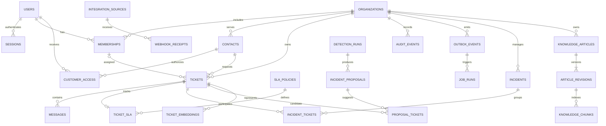

# Preliminary data model — future releases

M1 creates **only the Alembic version table**. The baseline revision is intentionally
empty: adding business tables now would begin M2/M3 without approval.
This document is a design, not a claim that these tables exist.

| Release | Tables / purpose |
| --- | --- |
| 0.1 / M2 | users, sessions, organizations, memberships; fixed Owner/Administrator/Agent roles |
| 0.1 / M3 | contacts, tickets, messages, categories, audit_events |
| 0.2 | customer_access, invitations, account_tokens, notifications, outbox_events, job_runs, sla_policies, ticket_sla, integration_sources, webhook_receipts |
| 0.3 | incidents, incident_tickets, incident_proposals, proposal_tickets, detection_runs, ticket_embeddings |
| 1.1 | knowledge_articles, article_revisions, knowledge_chunks, ai_runs, ai_suggestions, suggestion_feedback |

Every tenant-owned record has organization_id. Composite tenant foreign keys prevent
cross-organization references. UUID PKs, timezone-aware UTC timestamps, explicit
constraints, and query-specific indexes are the defaults. Messages unify public replies
and internal notes but customer response schemas exclude internal content.

Important constraints: unique organization/user membership; source/external-event ID;
event/handler logical job; recipient/event/type notification; active incident/ticket link;
ticket/source-version/model-revision embedding. Duplicate event IDs with different
payload digests are conflicts. Ticket versions guard concurrent assignment/status updates.

Likely indexes: organization/status/creation ticket queue; organization/assignee/status;
organization/requester/creation; organization/ticket/creation messages; partial unresolved
SLA deadline index; partial pending-work index; organization/target/time audit timeline;
GIN full-text search. Measure plans before adding indexes or approximate vector search.

Transactions cover whole use cases: ticket+first message+audit+outbox, reply+first-response
timestamp, proposal confirmation+incident links. No external API or SMTP call runs inside
a database transaction. Deleting/anonymizing source data must also address embeddings,
derived output, logs, and retention obligations in release 1.0.
