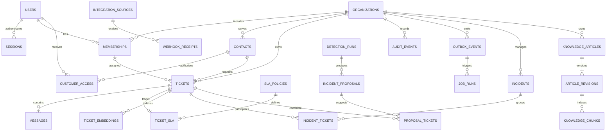

# Data model — implemented core and future releases

M1 creates only the Alembic version table. M2 migration `0002_identity` adds users,
sessions, organizations and memberships. M3 migration `0003_tickets` adds contacts,
categories, tickets, messages and audit_events. M4-M6 add customer access/jobs, SLA,
and integrations as described below. M7 adds incident and deterministic Radar tables.
M8 adds the semantic index described in [semantic-retrieval.md](semantic-retrieval.md).
M9 adds database policy/role configuration without adding business-domain tables;
generative AI tables remain future designs.
See [identity design](identity.md) and [ticket design](tickets.md) for implemented
constraints, transactions, indexes and the current ER diagram.

| Release | Tables / purpose |
| --- | --- |
| 0.1 / M2 | users, sessions, organizations, memberships; fixed Owner/Administrator/Agent roles |
| 0.1 / M3 | contacts, tickets, messages, categories, audit_events |
| 0.2 / M4 | customer_access, invitations, account_tokens, notifications, outbox_events, background_jobs, email_deliveries |
| 0.2 / M5 | sla_policies, sla_policy_versions, ticket_slas |
| 0.2 / M6 | integration_sources, webhook_receipts; integration actor references on tickets, messages and audit_events |
| 0.3 / M7 | incidents, incident_tickets, incident_events, radar_runs, radar_proposals, radar_proposal_tickets, radar_suppressions |
| M8 | ticket_embeddings: local 384-dimensional vectors, source digest/version, model and retry/index state |
| M9 | RLS policies and `supportflow_runtime` role; no new application domain tables |
| 1.1 | knowledge_articles, article_revisions, knowledge_chunks, ai_runs, ai_suggestions, suggestion_feedback |

Every tenant-owned record has organization_id. Composite tenant foreign keys prevent
cross-organization references. UUID PKs, timezone-aware UTC timestamps, explicit
constraints, and query-specific indexes are the defaults. Messages unify public replies
and internal notes but customer response schemas exclude internal content.

Important constraints: unique organization/user membership; source/external-event ID;
event/handler logical job; recipient/event/type notification; active incident/ticket link;
organization/group/fingerprint proposal identity. Duplicate event IDs with different
payload digests are conflicts. Ticket versions guard concurrent assignment/status updates.

Likely indexes: organization/status/creation ticket queue; organization/assignee/status;
organization/requester/creation; organization/ticket/creation messages; partial unresolved
SLA deadline index; partial pending-work index; organization/target/time audit timeline;
GIN full-text search; embedding dispatch/current-model indexes. M8 initially uses exact
tenant-filtered pgvector cosine distance rather than an approximate vector index; measure
plans and filtered recall before considering ANN.

Transactions cover whole use cases: ticket+first message+audit+outbox, reply+first-response
timestamp, proposal confirmation+incident links. No external API or SMTP call runs inside
a database transaction. Deleting/anonymizing source data must also address embeddings,
derived output, logs, and retention obligations in release 1.0.
