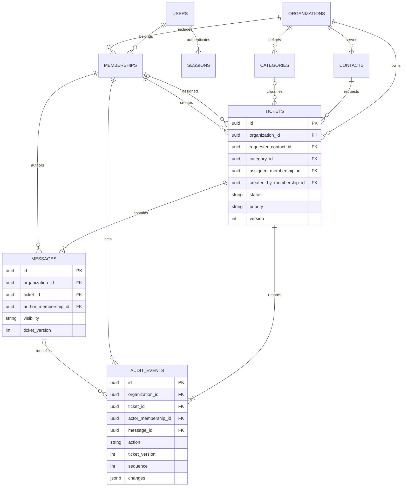

# M3 — Ticket management, conversations and audit history

M3 completes the staff helpdesk in release 0.1. It introduces no new dependencies or
services. Identity/tenancy remains the authorization boundary; the ticket module owns
contacts, categories, workflow, conversation and audit. All routes use synchronous
SQLAlchemy in FastAPI's synchronous handlers. No external call runs in a transaction.

## Staff permissions

Every operation requires an authenticated, active user and current active membership
in the URL organization. Session organization selection is a convenience, not a grant.
Knowing a resource UUID grants no access. Nonmembers and wrong-tenant IDs get safe 404s;
an active member without working/management permission gets 403. Invalid workflow or
reference state (including the closed-ticket reopening rule) gets 422. Stale ticket
versions get 409 after authorization.

| Operation | Owner | Administrator | Agent |
| --- | --- | --- | --- |
| List/search/read tickets, staff conversation and activity | All own-org tickets | All own-org tickets | All own-org tickets |
| Create/update contact name/email | Yes | Yes | Yes |
| Archive/restore contact | Yes | Yes | No |
| List categories | Yes | Yes | Yes |
| Create/rename/deactivate/reactivate category | Yes | Yes | No |
| Create ticket | Any active assignee or unassigned | Same | Self-assigned or unassigned |
| Change priority/category/status; reply/note | All tickets under workflow rules | Same | Only unassigned or self-assigned tickets |
| Assign/reassign/unassign | Any active own-org member | Same | Claim unassigned to self; release own assignment |
| Reopen a closed ticket | Yes | Yes | No |
| Edit/delete a message or audit event | No | No | No |

This is a shared support queue: Agents can read colleagues' work and internal notes,
but cannot take over or alter work assigned to someone else. Managers can recover
tickets assigned to disabled staff. Disabling/removing a membership preserves historical
attribution and assignments but immediately prevents new assignment and staff access.
The UI mirrors capabilities returned by the server; backend services enforce them.

## Ticket workflow

| Current status | Allowed changes | Meaning |
| --- | --- | --- |
| `open` | `pending`, `resolved` | Active support work |
| `pending` | `open`, `resolved` | Waiting for information; no automatic time/SLA behavior |
| `resolved` | `open`, `closed` | Resolution recorded; internal notes still allowed |
| `closed` | `open`, manager only | Finalized; reopen in a separate request before editing |

Priorities: `low`, `normal` (default), `high`, `urgent`. Public staff replies create a
customer notification/outbox event in the same transaction; SMTP delivery is asynchronous.
Internal notes do not notify customers. SLA side effects are not implemented. Public replies require open/pending; notes require
open/pending/resolved and working permission. Replies never change status implicitly.
Same-value PATCH on a nonclosed ticket checks its version but creates no audit/version.
A closed ticket accepts only a manager's isolated `status=open` change.

Tickets start at version 1. The initial customer request is an immutable public Message,
recorded by the staff intake author on the contact's behalf. It is not duplicated in a
description column and does not count as a first staff response. Title and requester
are fixed after creation in M3; the mutable fields are status, priority, category and assignment.
The first actual public reply sets `first_response_at`; notes do not. First resolution
sets `first_resolved_at`. Reopening clears current `resolved_at`/`closed_at`, preserving
both first-response and first-resolution timestamps. Timestamps are timezone-aware UTC.

Contacts use UUIDs, name, optional normalized email, active flag and timestamps. Email
is not unique for contacts: these are customer records, not accounts or verified access
grants. DELETE archives rather than destroys a contact; historic tickets remain readable.
New tickets cannot reference archived contacts. Category names collapse whitespace at
validation; a stored PostgreSQL-generated lowercase/space-normalized name is unique per
organization even when inactive. Rename preserves IDs; deactivation preserves history
and prevents new use. Existing inactive category links do not prevent unrelated edits.

## API contract

All paths below start with `/api/organizations/{organization_id}`. Every mutation uses
the existing exact-Origin and `X-CSRF-Token` checks; obtain the token from `/api/auth/csrf`
with the same cookie session. OpenAPI at `/api/docs` includes typed request/response schemas.

| Method | Suffix | Purpose |
| --- | --- | --- |
| POST / GET | `/contacts` | Create / search and page contacts |
| GET / PATCH / DELETE | `/contacts/{contact_id}` | Read / edit or restore / archive |
| POST / GET | `/categories` | Create / list categories |
| PATCH | `/categories/{category_id}` | Rename or set `is_active` |
| POST / GET | `/tickets` | Create / filter, search, sort and page queue |
| GET / PATCH | `/tickets/{ticket_id}` | Read detail / versioned field changes |
| POST | `/tickets/{ticket_id}/replies` | Append a public reply |
| POST | `/tickets/{ticket_id}/notes` | Append an internal note |
| GET | `/tickets/{ticket_id}/messages` | Staff conversation, including notes |
| GET | `/tickets/{ticket_id}/public-conversation` | Public-only projection; still staff-authenticated |
| GET | `/tickets/{ticket_id}/activity` | Authorized append-only activity |

Create example (use actual scoped UUIDs):

```json
{
  "requester_contact_id": "00000000-0000-0000-0000-000000000001",
  "title": "Unable to complete checkout",
  "initial_message": "The payment page times out.",
  "priority": "high",
  "category_id": null,
  "assigned_membership_id": null
}
```

PATCH example: `{"expected_version": 1, "priority": "urgent"}`.
Reply/note example: `{"expected_version": 2, "body": "We are investigating."}`.
Explicit null clears category/assignment. Unknown input fields are rejected; clients
cannot inject organization, actor, timestamps, visibility or version increments.
Titles are 1–200 characters, contact names 1–100, categories 1–80 and message bodies
1–10,000 after validation. Blank content and control characters are rejected; bodies
allow newlines/tabs. React renders text without interpreting HTML or Markdown.

Queue query parameters:

- `q`: case-insensitive literal substring of title, requester name or email; max 200.
  `%` and `_` are escaped, not user-supplied SQL patterns. Conversation bodies are not searched.
- `status`, `priority`, `category_id`, `assigned_to`, `unassigned`, `requester_id`.
  Foreign-tenant filter IDs never expand visibility; at most they return an empty page.
- `sort`: `created_desc` (default), `created_asc`, `updated_desc`, `priority_desc`.
- `page`: 1–10,000; `page_size`: 1–100 (default 20). UUID tie-breakers make ordering stable.

Contact lists support `q`, `include_inactive`, `page`, `page_size`, sorted by name/UUID.
Category lists accept `include_inactive`. Queue/contact pagination is bounded offset
pagination, not a snapshot: new writes between pages can shift results. Search scans
tenant-scoped text; full-text/trigram infrastructure awaits measured need.
Conversation pages use `after_version` (default 0), `limit` 1–100 (default 50), and
`next_after_version`. Activity uses the same cursor, default 20 *versions*, returning
whole version groups (at most four events per version) so multi-field edits are not split.
The UI exposes Load more for histories and page controls for queues/contacts.

## Tenant boundaries and schema



Every new table has organization_id and an organization FK. Ticket references use
`(organization_id, requester_contact_id/category_id/assigned_membership_id/created_by_membership_id)`
against parent `(organization_id,id)` unique keys. Message references constrain both
ticket and staff author to that organization. Audit references constrain ticket/actor;
its optional message FK also includes ticket_id so it cannot point at a different
ticket's message even within one tenant. No cascading deletion destroys history.
Database checks cover enum values, positive versions, nonblank bounded messages and
consistent status/lifecycle timestamps. SQL constraints reinforce relationships; they
do not replace membership/active-state checks or the service transition rules.

Queue indexes lead with organization and status/created, assignment/updated,
category/created, requester, or updated timestamp. Contact indexing starts with
organization. Unique message `(org,ticket,version)` and audit `(org,ticket,version,sequence)`
indexes support deterministic staff timelines; a visibility-prefixed message index
supports public-only retrieval. Detail/list use joined projections, avoiding a query
per ticket for requester/category/assignee. Index expansion requires measured plans.

## Atomic transactions and concurrency

```mermaid
sequenceDiagram
    participant UI as Staff browser
    participant API as FastAPI / identity dependencies
    participant S as Ticket service
    participant DB as PostgreSQL
    UI->>API: PATCH + CSRF + expected_version
    API->>S: Validated request and current identity
    S->>DB: Short transaction; organization FOR SHARE
    S->>DB: Refresh active membership / role
    S->>DB: Scoped ticket FOR UPDATE; refresh row
    alt Unauthorized or stale version
        S->>DB: ROLLBACK
        S-->>UI: 403/404 or 409 version_conflict
    else Authorized and current
        S->>DB: Validate transition / active scoped references
        S->>DB: Update version / fields; insert message if any; audit
        S->>DB: COMMIT
        S-->>UI: New ticket version and capabilities
    end
```

Optimistic concurrency means a user edits the version they read without retaining a
database lock while thinking. A short row lock during submission makes the version
comparison and mutation indivisible: the second writer waits, refreshes the row, then
receives 409 rather than overwriting the first. Successful effective edits, replies and
notes increment once. A no-op cannot bypass the version check. Independent-session
tests preload the old ticket then synchronize competing assignment/status submissions.
Both operations must yield one success and one conflict, one version increment and one
corresponding audit change. Database statement/pool timeouts remain bounded by M1 settings.

M3 mutations first acquire a shared organization lock. M2 membership mutations acquire
an exclusive organization lock. Ticket writes on different tickets can proceed together;
membership changes wait, and any waiting M3 writer refreshes its rights/target after the
membership change commits. Contact/category shared locks protect new references against
concurrent archive/deactivation. Lock order is organization, ticket (if existing), then
referenced contact/category. No database lock survives an HTTP response.

A stale response contains the safe existing error envelope plus:
`{"code":"version_conflict","details":{"current_version":2}}`. Cross-tenant and
unauthorized writes never receive that version detail. The frontend preserves both
reply/note drafts, blocks further submission until reload, and asks the staff member to
review current values. It never silently reapplies a stale change.

## Conversation privacy and audit

Public replies and notes have different input operations; clients cannot set visibility.
The public DTO contains only message id, author display name, body and creation time.
The public query filters internal records in SQL and never returns their bodies or
staff-only fields. Its cursor is a staff paging mechanism; **this endpoint is not a
customer access API**. Customer access uses separate M4 endpoints and schemas; the full
messages/activity APIs remain staff-only. See [customer portal design](customer-portal.md).

Every successful create/change/message transaction writes audit records with scoped
actor membership, display-name snapshot, action, ticket target, timestamp and safe
metadata. Message events also identify the message target. Metadata holds field from/to
values or message/reference IDs and visibility, not body text, passwords, session tokens
or credentials. Multi-field edits share a version and have ordered sequence numbers.
The activity UI resolves known category/assignee IDs using current labels; stored IDs
remain authoritative when names change. Failed authorization is rejected, not recorded
as a fabricated successful activity. Existing request logs carry route/status/request ID.

PostgreSQL triggers reject UPDATE/DELETE on messages and audit_events; no edit/delete
API exists. Audit failure rolls back the business operation, version/timestamps and
message together. These are append-only application records, not a tamper-proof ledger:
a privileged database owner can disable triggers or alter the schema. Retention,
anonymization, separate migration privileges and RLS are later hardening work.

## Demonstration and limits

Follow the [README staff demo](../README.md#try-the-staff-helpdesk). Add another synthetic
staff account through Organization & team to test Agent rights. Assign a ticket to the
owner: Agent can read it but cannot change it; unassign it and Agent can claim it.
Disable that Agent and confirm the next request is rejected. With two organizations,
use a valid contact/category/member/ticket UUID from the other tenant: the API rejects
the link, and direct invalid inserts fail PostgreSQL composite FK constraints.

M4 adds customer authentication, invitation/verification/recovery email, public portal
conversations, notifications and durable mail jobs. M3 has no attachments, rich-text editor, message editing,
ticket deletion/title/requester editing, tags, bulk actions, polling/live updates,
SLA, incidents, retrieval or AI. Categories/members are simple lists;
large-tenant lookup scaling is deferred. Lists are not snapshot-consistent across pages.
No performance benchmark or public production security claim is made. Use synthetic data
with the loopback-only HTTP Compose setup. M5 requires explicit approval.
